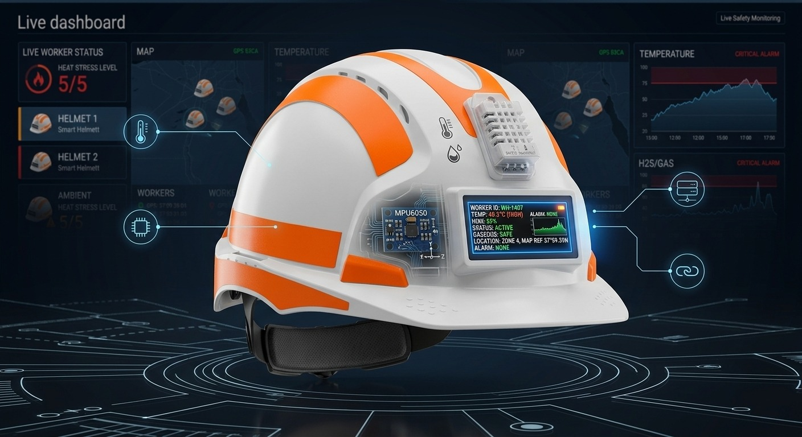
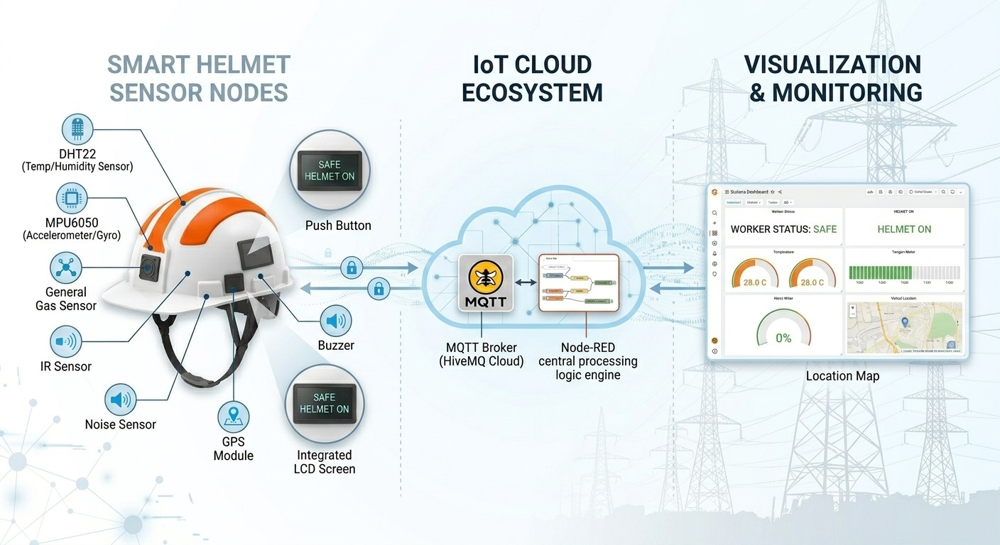
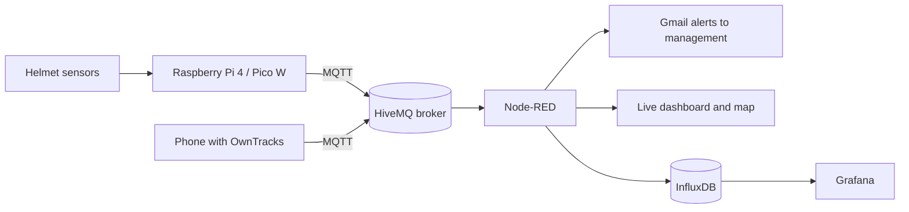

# 🪖 Safety Smart Helmet (SSH)

<p align="center">
  
</p>

<p align="center">
  <b>An IoT safety helmet that senses heat, gas, falls and noise, warns the worker on the spot, and alerts management in real time.</b>
</p>

<p align="center">
  
  
  
  
</p>

Graduation project for the **Samsung Innovation Campus - IoT** track.

> **Status:** working Wokwi simulation and a physical prototype (Raspberry Pi 4 + maquette).

---

## Table of Contents

1. [Problem Statement](#1-problem-statement)
2. [Solution Overview](#2-solution-overview)
3. [Business Model](#3-business-model)
4. [Features](#4-features)
5. [System Architecture](#5-system-architecture)
6. [Hardware](#6-hardware)
7. [Wokwi Simulation](#7-wokwi-simulation)
8. [Alert Logic](#8-alert-logic)
9. [MQTT Topics and Payloads](#9-mqtt-topics-and-payloads)
10. [Software Stack](#10-software-stack)
11. [Repository Structure](#11-repository-structure)
12. [Getting Started](#12-getting-started)
13. [Security Notes](#13-security-notes)
14. [Known Limitations](#14-known-limitations)
15. [Future Work](#15-future-work)
16. [Team](#16-team)
17. [License](#17-license)

---

## 1. Problem Statement

Oil-site workers face hazards that are usually noticed too late:

- **Extreme heat** during outdoor shifts of 12 hours or more.
- **Explosive and toxic air**: methane can ignite from a single spark, and gases such as CO2 silently displace breathable air.
- **Falls and impacts**: a worker who collapses alone on a large site may not be found quickly.

Existing safeguards (supervisor rounds, walkie-talkie check-ins, heat-stress training, a standard helmet that only absorbs impact) all depend on a person. Nothing senses and reports automatically, per worker, in real time.

## 2. Solution Overview

The Safety Smart Helmet performs four jobs:

1. **Detect** temperature, gas, falls and noise continuously.
2. **Warn** the worker immediately through a buzzer and an LCD.
3. **Alert** management by email, including a map link to the worker.
4. **Track** the worker's location and keep a history of every reading.

---

## 3. Business Model

The `docs/` folder contains the full **Project Opportunity Canvas & Business Case**:
[`docs/Business_Model.pptx`](docs/Business_Model.pptx).

| Aspect | Summary |
|---|---|
| **Customer** | Oil companies and upstream site operators |
| **Decision makers** | HSE officers and site managers |
| **End users** | Field workers wearing the helmet |
| **Problem** | Invisible hazards (heat, gas, falls) on vast sites where manual checks are slow and reactive |
| **Root cause** | Safety monitoring depends on people, not on continuous automatic sensing |
| **Value proposition** | Automatic detection, instant on-helmet warning, remote alerting with worker location, and a searchable history for audits and analytics |
| **Cost vs. risk** | Low prototype cost (about 1,000-1,500 EGP) compared with the financial, operational and human cost of an accident or site downtime |

Open the PowerPoint file for the complete canvas.

---

## 4. Features

- **Wear detection:** the system starts only when the helmet is worn and goes to standby when it is removed.
- **High-temperature warning** above 45 °C (with hysteresis, clears below 43 °C).
- **Gas warning:** MQ2 digital output on the Raspberry Pi prototype; low-oxygen estimate from the analog gas sensor in the simulation.
- **Fall detection:** impact followed by stillness, with a **cancel window** to avoid false alarms.
- **Noise warning** for loud environments (LCD + short beep, dashboard only, no email).
- **Acknowledge button** to silence the buzzer or cancel a fall alert.
- **Offline-safe alerting:** alerts are queued and re-sent when the MQTT connection returns.
- **Email alerts** to management through Gmail (Node-RED), with a Google Maps link.
- **Live dashboard** with gauges, worker status, alert list and a worker map (Node-RED).
- **History and analytics** in InfluxDB and Grafana.
- **Worker location** from a phone running OwnTracks (prototype) or simulated GPS (Wokwi).
- **Wokwi simulation** to test the full logic without hardware.

---

## 5. System Architecture





**Data flow:** sensors are read on the helmet controller, which drives the local buzzer and LCD and publishes telemetry (every 2 s) and alerts (per event) over MQTT. Node-RED subscribes, builds emails, drives the dashboard and map, and writes every reading to InfluxDB. Grafana visualises the history.

---

## 6. Hardware

### 6.1 Physical prototype (Raspberry Pi 4)

Code: [`Raspberry pi 4 code.py`](Raspberry%20pi%204%20code.py). Photos of the maquette are in [`Maquette screenshots/`](Maquette%20screenshots/).

| Part | Job |
|---|---|
| Raspberry Pi 4 | Main controller (Python) |
| DHT11 | Temperature and humidity |
| MQ2 gas sensor (DO output) | Gas detection |
| HW-484 sound sensor (DO output) | Noise detection |
| MPU6050 accelerometer | Fall detection |
| IR sensor | Helmet worn / removed |
| LCD 16x2 with I2C backpack | Messages for the worker |
| Buzzer | Audible alarm |
| LED + push button | LED toggle |
| Push button | Silence the buzzer / acknowledge |

Wiring notes:

- The MQ2 module runs at 5 V. Connect its digital output to the Pi through **one diode** (stripe toward the sensor `DO`) with the Pi's internal pull-up enabled, or use a level shifter. **Never connect a 5 V output directly to a GPIO.**
- The sound module can run at 3.3 V, so its `DO` can go straight to a GPIO.
- The LCD (`0x27` or `0x3F`) and the MPU6050 (`0x68`) share the I2C bus.

**Pin mapping (BCM numbering, editable in the code):**

| Function | GPIO |
|---|---|
| IR sensor | 17 |
| Sound sensor DO | 22 |
| MQ2 DO | 21 |
| Silence button | 24 |
| LED button | 16 |
| Buzzer | 18 |
| LED | 25 |
| DHT11 | 4 |
| I2C SDA / SCL | 2 / 3 |

### 6.2 Simulated hardware (Raspberry Pi Pico W in Wokwi)

| Real-world function | Wokwi part | Pico W pin |
|---|---|---|
| Temperature | DHT22 | GP2 |
| Helmet worn / removed | PIR motion sensor | GP14 |
| Noise level | Potentiometer (maps to 40-120 dB) | GP27 (ADC) |
| Gas / low oxygen | Gas sensor, analog output `AOUT` | GP28 (ADC) |
| Fall detection | MPU6050 (I2C) | GP0 (SDA) / GP1 (SCL) |
| Worker display | LCD1602 with I2C | GP0 (SDA) / GP1 (SCL) |
| Audible alarm | Buzzer (PWM, 2 kHz) | GP15 |
| Acknowledge / cancel | Push button (active low, pull-up) | GP16 |
| GPS | Simulated random walk (or real UART GPS) | UART1: TX GP4 / RX GP5 |

---

## 7. Wokwi Simulation

The simulation was rebuilt from scratch with updated MicroPython firmware, a new circuit and a richer fall-detection algorithm.

- **Live project:** <https://wokwi.com/projects/477620663875381249>
- **Files:** [`Wokwi simulation/main.py`](Wokwi%20simulation/main.py), [`diagram.json`](Wokwi%20simulation/diagram.json), [`umqtt_simple.py`](Wokwi%20simulation/umqtt_simple.py)


### 7.1 How the code works

The firmware runs a single non-blocking loop (50 ms tick). Each iteration checks whether the helmet is worn; if not, it only flushes pending alerts and waits.

| Module | Behaviour |
|---|---|
| `check_wear()` | The PIR output marks "last motion". The helmet counts as worn if motion was seen within `WEAR_TIMEOUT` (5 minutes), so alarms are not cut off while a worker stands still. On removal, all alarms are reset and the system enters standby. |
| `check_temp()` | Reads the DHT22. Alarm above **45 °C**, clears below **43 °C** (hysteresis). Sends a `high_temp` alert once per event. |
| `check_gas()` | Converts the analog gas reading into an estimated oxygen percentage (`o2 = 100 - gas% × 0.3`). Alarm below **90 %**, clears at **92 %** or more. Sends a `gas` alert. |
| `check_noise()` | Potentiometer mapped to 40-120 dB. Alarm above **85 dB**, clears below **80 dB**. Produces a single 1-second beep, no email. |
| `check_fall()` | Four-state machine (see below). |
| `update_outputs()` | Drives the buzzer and refreshes the LCD every 500 ms. |
| `update_gps()` | Simulated GPS drifting around `BASE_LAT/BASE_LON`. Set `USE_REAL_GPS = True` to parse NMEA `GGA` sentences from a real module on UART1. |
| `publish_alert()` / `flush_alerts()` | Alerts are queued and sent when the broker is reachable, so none are lost on a connection drop. |
| `mqtt_connect()` | Retries at most every 15 s so the helmet loop never blocks. |

### 7.2 Fall detection state machine

| State | Meaning | Transition |
|---|---|---|
| `0` Idle | Monitoring acceleration | Magnitude above `FALL_IMPACT_G` (1.8 g) goes to state 1 |
| `1` Wait for stillness | Impact seen, checking for no movement | Acceleration within ±0.15 g of 1 g for 1.5 s goes to state 2; times out after 8 s back to state 0 |
| `2` Cancel countdown | LCD shows `FALL? BTN Ns`, buzzer on | Button press cancels (state 0); after 5 s the alert is sent (state 3) |
| `3` Alert sent | `FALL ALERT SENT` on the LCD | Button press resets to state 0 |

The MPU6050 is configured for the **±8 g** range. The Wokwi slider only reaches 2 g, so the impact threshold is 1.8 g in the simulation; use **2.5-3 g** on real hardware.

### 7.3 LCD output

- **Line 1:** `T:xx.xC O2:xx%`
- **Line 2 (priority order):** fall countdown, `FALL ALERT SENT`, `HIGH TEMPERATURE`, `GAS LEAK! LOW O2`, `HIGH NOISE xxdB`, otherwise `Noise:xxdB OK`.

### 7.4 Running the simulation

1. Open the Wokwi project link above (or create a **Raspberry Pi Pico W** MicroPython project and paste `diagram.json`).
2. Add `main.py` and `umqtt_simple.py`.
3. Press **Play**. The simulation connects to `Wokwi-GUEST` Wi-Fi and the MQTT broker.
4. Trigger the PIR sensor so the helmet counts as worn, then move the DHT22, gas, potentiometer and MPU6050 controls to test each alarm.

---

## 8. Alert Logic

| Condition | Helmet reaction | Alert type | Email |
|---|---|---|---|
| Helmet worn | LCD shows "Helmet ON / System started" | none | No |
| Temperature above 45 °C | Buzzer + LCD warning | `high_temp` / `fire` | Yes |
| Gas detected / oxygen below 90 % | Buzzer + LCD warning | `gas` | Yes |
| Fall (impact + stillness, not cancelled) | Buzzer + countdown, then alert | `fall` | Yes |
| Noise above 85 dB | Single beep + LCD message | none | No (dashboard only) |

The button silences temperature and gas buzzers and cancels a pending fall alert.

Differences between the two versions:

| | Raspberry Pi prototype | Wokwi simulation |
|---|---|---|
| Wear sensor | IR | PIR (motion within 5 min) |
| Gas | MQ2 digital (`0` / `100`) | Analog, converted to O2 % |
| Noise | HW-484 digital | Potentiometer, 40-120 dB |
| Fall rule | Change of 1.2 g or more between two readings | Impact above 1.8 g + stillness + cancel window |

---

## 9. MQTT Topics and Payloads

### 9.1 Wokwi simulation

Broker: `broker.hivemq.com`, port `1883` (public broker, no TLS, for testing only).

| Topic | Direction | Content |
|---|---|---|
| `helmet/h01/telemetry` | device to Node-RED | Readings every 2 s |
| `helmet/h01/alert` | device to Node-RED | One message per event |

Telemetry:

```json
{"temp": 31.5, "o2": 98.4, "noise": 52.0, "lat": 30.000021, "lon": 31.000013, "worn": 1, "fall": 0}
```

Alert (`type` is `high_temp`, `gas` or `fall`):

```json
{"type": "high_temp", "temp": 47.2, "o2": 98.4, "noise": 52.0, "lat": 30.000021, "lon": 31.000013}
```

### 9.2 Raspberry Pi prototype

Broker: **HiveMQ Cloud** (TLS, port `8883`, username and password).

| Topic | Direction | Content |
|---|---|---|
| `so-m8k2/helmet/telemetry` | device to Node-RED | Readings every 2 s |
| `so-m8k2/helmet/alerts` | device to Node-RED | One message per event |
| `owntracks/+/+` | phone to Node-RED | Worker location (OwnTracks) |

```json
{"worn": 1, "status": "SAFE", "temp": 31.5, "gas": 0, "accel": 1.02, "noise": 0}
```

`status` is one of `SAFE`, `FIRE`, `GAS`, `FALL`, `NOISE`, `NOT WORN`. With digital sensors, `gas` and `noise` are `0` or `100`.

> The Node-RED flow must subscribe to the topics of the version you are running.

---

## 10. Software Stack

| Tool | Role |
|---|---|
| Python 3 / MicroPython | Device firmware (Raspberry Pi 4 / Pico W) |
| MQTT (HiveMQ) | Messaging |
| Node-RED | Alert logic, Gmail notifications, dashboard, map |
| OwnTracks | Worker location from a phone |
| InfluxDB v2 | Time-series storage |
| Grafana | History dashboard |
| Wokwi | Hardware simulation |

### Node-RED

Required palettes: `node-red-dashboard`, `node-red-node-email`, `node-red-contrib-web-worldmap`, `node-red-contrib-influxdb`.

The flow subscribes to telemetry, alerts and OwnTracks; builds the alert email (message, readings, Google Maps link) and sends it via Gmail SMTP (use an **App Password**); prefers the OwnTracks location when it is under 5 minutes old; serves the dashboard at `http://<node-red-ip>:1880/ui` and the map at `http://<node-red-ip>:1880/worldmap/`; and writes every telemetry message to InfluxDB. Flow and dashboard screenshots are in [`node-red/`](node-red/).

### InfluxDB

- Organization `smart-helmet`, bucket `helmet_data`, measurement `helmet_telemetry`.
- Tags: `device_id`, `status`.
- Fields: `temp`, `gas`, `accel`, `noise`, `lat`, `lon`, `worn`.

### Grafana

Import [`Grafana Dashboard.json`](Grafana%20Dashboard.json) ("Smart Helmet - Oil Site Safety"): worker status, helmet on/off, location map, temperature, gas, noise, history chart and event timeline. Data source: InfluxDB (Flux) with a read-only token.

```flux
from(bucket: "helmet_data")
  |> range(start: -1m)
  |> filter(fn: (r) => r._measurement == "helmet_telemetry" and r._field == "temp")
  |> group()
  |> sort(columns: ["_time"])
  |> last()
```

---

## 11. Repository Structure

```text
Safety-Smart-Helmet/
├── docs/
│   ├── architecture.jpeg          # System architecture diagram
│   ├── Business_Model.pptx        # Project Opportunity Canvas & Business Case
│   └── cover.jpeg                 # README cover image
├── Maquette screenshots/          # Photos of the physical prototype (maquette)
├── node-red/                      # Node-RED flow and dashboard screenshots
├── Wokwi simulation/
│   ├── main.py                    # Pico W MicroPython firmware
│   ├── diagram.json               # Wokwi circuit definition
│   ├── umqtt_simple.py            # Lightweight MQTT client
│   ├── circuit.png                # Circuit screenshot
│   └── wokwi-project.txt          # Link to the Wokwi project
├── Grafana Dashboard.json         # Grafana dashboard export
├── Raspberry pi 4 code.py         # Raspberry Pi 4 prototype code
└── README.md
```

---

## 12. Getting Started

### 12.1 Raspberry Pi 4 prototype

```bash
sudo raspi-config                  # Interface Options -> I2C -> Enable
sudo apt update
sudo apt install -y python3-pip python3-venv i2c-tools libgpiod2

python3 -m venv --system-site-packages ~/helmet-env
source ~/helmet-env/bin/activate
pip install paho-mqtt smbus2 RPLCD adafruit-circuitpython-dht

i2cdetect -y 1                     # LCD (27 or 3f) and MPU6050 (68) should appear
```

Set your HiveMQ credentials in the code (see [Security Notes](#13-security-notes)), then run:

```bash
python3 "Raspberry pi 4 code.py"
```

### 12.2 Wokwi simulation

Follow [section 7.4](#74-running-the-simulation). To use a private broker, change `MQTT_HOST` in `main.py` and pass `user`, `password` (and `ssl=True`) to `MQTTClient`.

### 12.3 Cloud and dashboards

1. Create a HiveMQ Cloud cluster and a credential with publish and subscribe permission.
2. Install the Node-RED palettes, import the flow from `node-red/`, and enter the broker credentials and the Gmail App Password in the nodes.
3. Create the InfluxDB organization, bucket and tokens, then import `Grafana Dashboard.json`.
4. OwnTracks app: Mode = MQTT, host = your HiveMQ host, port = 8883, TLS on, same credentials.

---

## 13. Security Notes

- **Never commit real credentials.** Use placeholders in the repository (`YOUR_USER`, `YOUR_PASSWORD`, `YOUR_INFLUX_TOKEN`) and keep real values in a local file listed in `.gitignore`.
- The Wokwi simulation uses a **public, unauthenticated broker**; anyone can read those topics. Use it for testing only and never send real worker data through it.
- Use a strong HiveMQ password. If one was ever shown in a screenshot or pushed to GitHub, change it.
- Use a Gmail **App Password** for the email node, never your normal password.
- OwnTracks sends a real location: protect its topic with credentials.

---

## 14. Known Limitations

- Digital MQ2 and sound outputs only report "detected / not detected"; sensitivity is set with the module's trimmer.
- MQ2 needs a few minutes of warm-up and detects flammable gas and smoke, not oxygen. In the simulation, oxygen is an **estimate** derived from the gas reading.
- DHT11 accuracy is about ±2 °C and it can be read at most once per second.
- The MPU6050 must be set to a wider range than the default ±2 g to register strong impacts.
- Fall detection is threshold-based and may give false alarms or miss slow falls; the cancel button reduces false alerts.
- The PIR-based wear detection in the simulation infers "worn" from recent motion, not from direct contact.
- The simulation replaces some real parts (potentiometer for sound, PIR for the IR sensor, simulated GPS).

---

## 15. Future Work

- Real gas concentration using an analog sensor and an ADC, plus a true oxygen sensor.
- A GPS module mounted on the helmet instead of the phone.
- Worker vitals with a SpO2 / heart-rate sensor (MAX30102).
- Thresholds editable from the dashboard.
- Improved fall detection (machine-learning or multi-sensor fusion).
- Helmet casing, battery power and a final industrial design.

---

## 16. Team

- **Alaa Arafa**
- **Amaal Abdo**
- **Menna Badr**
- **Mazen Ismail**
- **Mohamed Samir**

---

## 17. License

This project is licensed under the MIT License. See the `LICENSE` file for details.
